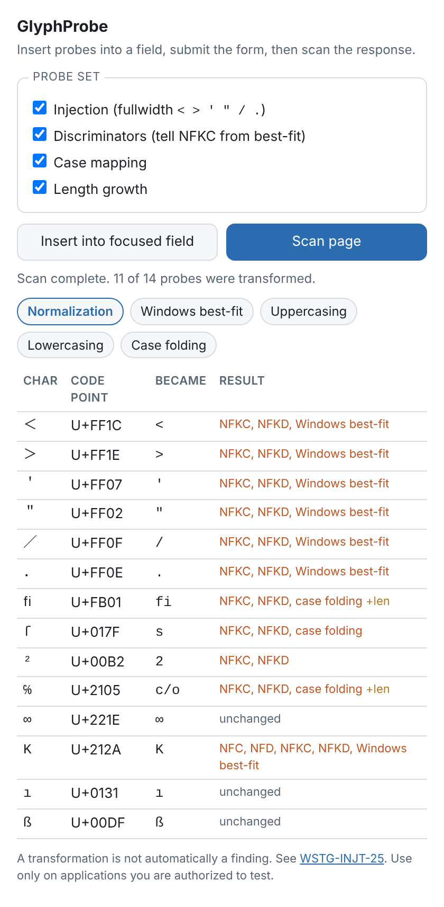

# GlyphProbe

[](https://github.com/enesbaldemir/glyphprobe/actions/workflows/test.yml)
[](LICENSE)

**A Chrome extension that detects how a web application transforms text input** —
Unicode normalization (NFC/NFD/NFKC/NFKD), case mapping, case folding, or Windows
best-fit. You insert marked probe characters into a field, submit the form, and
GlyphProbe reads the response and tells you what each character became **and which
transform did it**.

<p align="center">
  
</p>

[Türkçe](#türkçe)

## Why this matters

A security check that runs **before** a transform can be bypassed by a character
that becomes the blocked one only *after* it passes the filter. A filter that
blocks `<`, `'` or `../` lets the fullwidth `＜`, `＇` or `．．／` through, and the
code that runs later gets `<`, `'` and `../` back. This is validating before
canonicalizing, [CWE-180](https://cwe.mitre.org/data/definitions/180.html), and it
turns a filter bypass into XSS, SQL injection or path traversal.

GlyphProbe supports the testing in OWASP WSTG
[Testing for Unicode Normalization and Case Mapping](https://owasp.org/www-project-web-security-testing-guide/latest/) (WSTG-INJT-25).

## What makes it different

Most tools hand you a list of tricky characters to paste. GlyphProbe tells you
what the application *did* with them, and separates the mechanisms that look
identical from the outside:

- A fullwidth `＜` becomes `<` under **both** NFKC and Windows best-fit, so on its
  own it can't say which. GlyphProbe adds discriminator probes: `∞` becomes `8`
  **only** under Windows best-fit, while `fi`, `ſ` and `²` become ASCII **only**
  under normalization. The report names the mechanism in play, not just "it
  became ASCII".
- It flags **length growth** (`ß` → `SS`, `℅` → `c/o`), which can defeat a length
  check applied before the transform.
- The best-fit table is derived from Unicode's `bestfit1252.txt`, the data that
  actually distinguishes Windows ANSI best-fit from NFKC.

> **Authorized testing only.** Use GlyphProbe on applications you own or have
> explicit permission to test.

## Try it in two minutes

The repository ships a self-contained demo page that transforms input the way a
server would, so you can see detection work without a live target.

```bash
git clone https://github.com/enesbaldemir/glyphprobe
cd glyphprobe
# load the extension:
#   chrome://extensions → Developer mode → Load unpacked → this folder
# serve the demo (content scripts need http, not file://):
cd demo && python -m http.server 8000
```

Open <http://localhost:8000>, right-click the field → **Insert GlyphProbe
probes**, pick a **Server behaviour** (try `NFKC`, then `Windows best-fit`), click
**Reflect**, then open the popup and click **Scan page**. The named mechanism
should match the mode you picked.

## Install

1. `git clone` this repository.
2. Open `chrome://extensions`, turn on **Developer mode**.
3. **Load unpacked**, and select the repository folder.

Works in Chrome, Edge, Brave and other Chromium browsers.

## Use

1. Right-click a text field and choose **Insert GlyphProbe probes** (or click into
   the field and use **Insert into focused field** in the popup).
2. Submit the form or trigger the request as usual.
3. Open the popup and click **Scan page**.
4. Read the report: for each probe, what it became and which transform produced
   it, with a summary of the mechanisms in play.

A transformation is **not** automatically a finding. It matters when it happens
after validation, filtering or a length check. Confirm the order before
reporting.

## How detection works

Each probe is wrapped in an ASCII marker (`uprb00`, `uprb01`, …) so it can be
found again in the response even after the value is reflected or reordered. For
each probe, GlyphProbe compares the observed value against every transform
(`String.normalize`, case mapping, a case-folding table, and the best-fit map)
and reports the matches. The engine runs without a browser and is covered by
`node test/run.js`.

## Limitations (v0.1)

- Detection relies on the submitted value being **reflected** in the page the
  popup scans (the response page, or the same page for an AJAX flow). Values that
  are stored and shown elsewhere, or never reflected, are reported as "not
  reflected".
- It reads the rendered page text and form values, not raw network responses. A
  DevTools panel that inspects responses directly is planned.
- Case folding is approximated from a table for the probe characters, since the
  browser has no case-folding API.

## License

Code is released under the [MIT License](LICENSE). The best-fit mapping in
`src/data/bestfit.js` is derived from Unicode Character Database data; see
[NOTICE](NOTICE).

---

## Türkçe

Bir web uygulamasının metin girdisini nasıl dönüştürdüğünü tespit eden bir Chrome
uzantısı: Unicode normalizasyonu (NFC/NFD/NFKC/NFKD), büyük-küçük harf eşlemesi,
case folding ve Windows best-fit. Bir alana işaretli test karakterleri
yerleştirir, formu gönderirsin, GlyphProbe gelen yanıtı okuyup her karakterin
neye dönüştüğünü **ve bunu hangi dönüşümün yaptığını** söyler.

### Neden önemli?

Dönüşümden **önce** çalışan bir güvenlik kontrolü, ancak filtreden geçtikten sonra
yasaklı karaktere dönüşen bir karakterle atlatılabilir. `<`, `'` ya da `../`
engelleyen bir filtre, fullwidth `＜`, `＇` ya da `．．／` karakterini geçirir;
sonra çalışan kod bunları `<`, `'`, `../` olarak alır. Bu, doğrulamadan önce
kanonikleştirmedir ([CWE-180](https://cwe.mitre.org/data/definitions/180.html)) ve
bir filtre atlatmayı XSS, SQL injection ya da path traversal'a çevirir.

OWASP WSTG **Testing for Unicode Normalization and Case Mapping** (WSTG-INJT-25)
bölümündeki testleri destekler.

### Farkı ne?

Çoğu araç sana yapıştırman için garip karakterler verir. GlyphProbe ise
uygulamanın o karakterlerle **ne yaptığını** söyler ve dışarıdan aynı görünen
mekanizmaları ayırır: `∞` yalnızca Windows best-fit'te `8` olur, `fi`/`ſ`/`²` ise
yalnızca normalizasyonda ASCII olur. Rapor, "ASCII oldu" demekle kalmaz, hangi
mekanizmanın çalıştığını söyler. Ayrıca uzunluk artışını da (`ß` → `SS`) işaretler.

> **Yalnızca yetkili testler için.** Sahibi olduğun ya da test izni olan
> uygulamalarda kullan.

### Kurulum ve kullanım

1. Depoyu `git clone` ile indir.
2. `chrome://extensions` → **Geliştirici modu** → **Paketlenmemiş yükle** → depo
   klasörünü seç.
3. `demo/` klasöründe `python -m http.server 8000` çalıştır, <http://localhost:8000>
   adresini aç ve demoyu dene.
4. Bir alana sağ tıkla → **Insert GlyphProbe probes** → formu gönder → popup'tan
   **Scan page**.

Bir dönüşümün görülmesi tek başına bir zafiyet değildir; önemli olan bunun
doğrulama ya da uzunluk kontrolünden sonra olmasıdır.

### Lisans

Kod [MIT Lisansı](LICENSE) ile yayınlanır. `src/data/bestfit.js` içindeki best-fit
eşlemesi Unicode Karakter Veritabanı verisinden türetilmiştir; bkz. [NOTICE](NOTICE).
